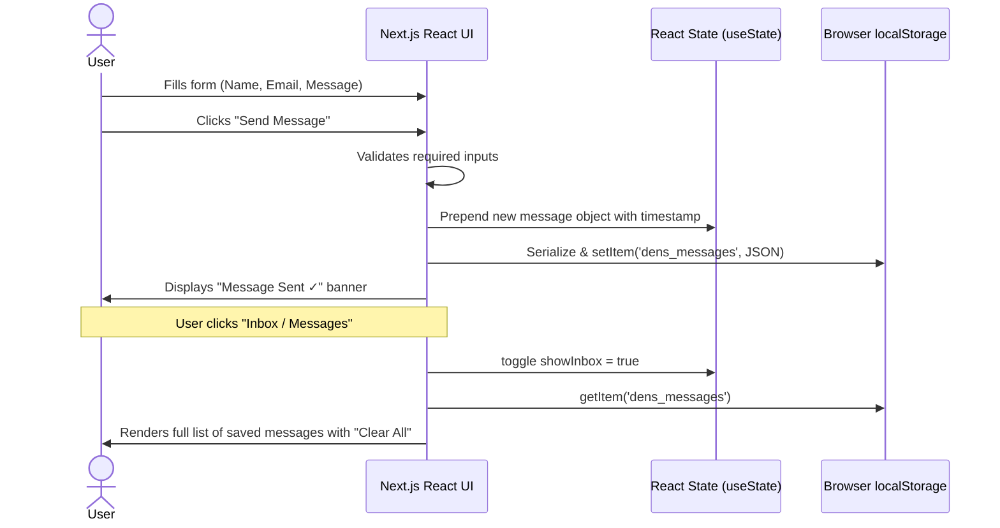
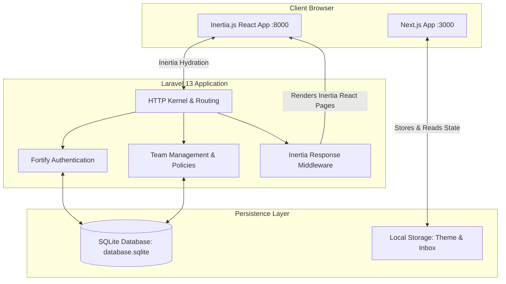

# Web 2: Full-Stack Web Application & Portfolio Platform

> **ITE183 — Web Development 2**  
> A high-performance, modular full-stack web application featuring an interactive **Next.js 16 + React 19** frontend and a robust **Laravel 13 + Inertia.js v3 + SQLite** authenticated backend.

---

## 📸 User Interface (UI) Attachments

### 1. Frontend UI — Dark Mode & Projects Showcase
The client application defaults to an ultra-clean, minimalist dark theme featuring a live project availability badge, dynamic category-filtered work showcase, and direct contact suite.


---

### 2. Frontend UI — Light Mode & Interactive Message Inbox
Switching themes toggles the full UI instantly with persistent local storage. The built-in interactive contact inbox allows users and reviewers to send messages and view them in real time without external mail server requirements.


---

### 3. System Architecture
How the Next.js client tier, Laravel Inertia.js backend tier, and SQLite database communicate seamlessly:


---

## 🖥️ UI Layout & Wireframe Representation

For fast reference in command-line terminals or headless viewers, below is the structural wireframe of the client UI:

```text
+---------------------------------------------------------------------------------------+
|  [D] DENS       About    Projects    Skills    Contact       [ ☀️ Light ]  [Contact Me] |
+---------------------------------------------------------------------------------------+
|                                                                                       |
|   (●) Available for Web 2 Projects                                                    |
|                                                                                       |
|   Hi, I'm Dens.                                                                       |
|   Web Developer.                                                                      |
|                                                                                       |
|   I build clean, simple, and high-performance web applications using                  |
|   React, Next.js, and Laravel.                                                        |
|                                                                                       |
|   [ VIEW PROJECTS ]   [ CONTACT ME ]                                                  |
|                                                                                       |
|   STACK:  [React]  [Next.js]  [Laravel]  [Tailwind CSS]  [PHP]  [SQLite]              |
|                                                                                       |
+---------------------------------------------------------------------------------------+
|  // ABOUT                                                                             |
|  [ Frontend Architecture ]     [ Backend & APIs ]          [ Engineering Philosophy ] |
|  React 19, Next.js, Tailwind   Laravel 13, Eloquent, PHP   Minimalist, fast, modular  |
+---------------------------------------------------------------------------------------+
|  // PROJECTS                                       Filter: [All] [Full Stack] [Frontend]
|                                                                                       |
|  +---------------------------+ +---------------------------+ +----------------------+ |
|  | FULL STACK                | | FRONTEND                  | | BACKEND / API        | |
|  | Laravel + React App       | | TriviaForge Quiz Engine   | | RESTful Auth API     | |
|  | Full-stack Web 2 platform | | Dynamic quiz builder and  | | Secure server with   | |
|  | with Inertia.js & React   | | interactive leaderboard   | | Fortify & Passkeys   | |
|  | [Laravel 11] [React 19]   | | [Next.js] [React]         | | [Laravel] [PHP 8.3]  | |
|  |                   Link -> | |                   Link -> | |              Link -> | |
|  +---------------------------+ +---------------------------+ +----------------------+ |
+---------------------------------------------------------------------------------------+
|  // CONTACT                                                                           |
|  +-------------------------------------+ +------------------------------------------+ |
|  | DIRECT CONTACT                      | | SEND A MESSAGE / INBOX                   | |
|  | Email: dens@gmail.com    [Copy ✓]   | | Name:    [ John Doe                   ]  | |
|  | Profile: [ GitHub Profile -> ]      | | Email:   [ john@example.com           ]  | |
|  |                                     | | Subject: [ Project Collaboration      ]  | |
|  | [ ✉ Inbox / Messages (2) ]          | | Message: [ Interested in your work!   ]  | |
|  | (Clicking swaps form with inbox)    | | [ SUBMIT MESSAGE ]                       | |
|  +-------------------------------------+ +------------------------------------------+ |
+---------------------------------------------------------------------------------------+
|  DENS | © 2026 Dens. All rights reserved.                About  Projects  Skills  [↑]  |
+---------------------------------------------------------------------------------------+
```

---

## ⚙️ How This System Works

The repository is structured into two decoupled, high-performance tiers located in `React_laravel/`:

```
Web_2/
├── docs/images/                 # UI diagrams and vector mockups
└── React_laravel/
    ├── frontend/                # Client Application (Next.js 16 + React 19)
    └── backend/                 # Full-Stack Application & API (Laravel 13 + Inertia.js + SQLite)
```

### 1. Frontend Tier (`React_laravel/frontend`)
The frontend is a modern **Next.js 16** web application using React 19 and Tailwind CSS v4.

* **Client-Side Reactivity (`"use client"`)**:
  - Implemented in `src/app/page.js` with instant state management and zero unnecessary round-trips.
* **Persistent Dark / Light Theme Engine**:
  - The active theme is stored in `localStorage.getItem("dens_theme")`.
  - When toggled via the navbar button, the document DOM smoothly transitions colors and preserves user preference across sessions.
* **Dynamic Category Filtering**:
  - Projects can be filtered in real-time between `All`, `Full Stack`, `Frontend`, and `Backend/API`.
  - Filter state (`activeFilter`) dynamically computes and renders the matching project cards.
* **Interactive Contact & Local Message Inbox**:
  - Users can copy the developer email (`dens@gmail.com`) to their clipboard with 1 click; the button responds with a dynamic `Copied! ✓` confirmation state.
  - Submitting the contact form performs immediate field validation (`name`, `email`, `message`).
  - Upon submission, a unique timestamped record is prepended to the message array and stored directly into the browser's `localStorage` (`dens_messages`).
  - Clicking the **Inbox / Messages** button switches the view to reveal an in-browser inbox viewer with message cards, timestamps, and a **Clear All** action.
  - **Advantage**: Requires no third-party email service (SendGrid, Mailgun) or SMTP server to demonstrate full interactive data handling.



---

### 2. Backend Tier (`React_laravel/backend`)
The backend is an enterprise-grade **Laravel 13** application powered by **Inertia.js v3**, **React 19**, and **TypeScript**.

* **Inertia.js Monolith-with-SPA Architecture**:
  - Bridges Laravel backend routes and React components without requiring REST API boilerplate.
  - Server routes return `Inertia::render('PageName', $props)` which hydratively mounts React pages (`resources/js/pages/`).
* **Laravel Fortify Authentication**:
  - Complete user management: Registration, Login, Password Reset, and Profile updates.
  - Built-in support for **Two-Factor Authentication (2FA)** with QR codes and recovery codes.
  - Integrated **WebAuthn / Passkeys** authentication via `@laravel/passkeys`.
* **Multi-Tenant Team Management**:
  - Built-in multi-tenancy where users can create teams, invite teammates via email tokens, switch active teams (`/{team}/dashboard`), and manage role-based permissions (Owner, Admin, Member).
* **Database & Persistence**:
  - Configured with a self-contained, high-speed **SQLite** database (`database/database.sqlite`).
  - Automated database migrations handle users, teams, passkeys, cache, and queue jobs.
* **Modern Development Pipeline (`php artisan dev`)**:
  - Laravel 13 includes an integrated multi-process manager that runs the PHP server (`php artisan serve`), background queue worker (`php artisan queue:listen`), real-time log viewer (`php artisan pail`), and the Vite dev server concurrently.



---

## 📂 Project Structure

```
Web_2/
├── docs/
│   └── images/
│       ├── ui-preview-dark.svg       # Dark mode UI mockup
│       ├── ui-preview-light.svg      # Light mode & inbox UI mockup
│       └── system-architecture.svg   # Architectural overview diagram
│
├── React_laravel/
│   ├── frontend/                     # Next.js Application
│   │   ├── public/                   # Static assets & icons
│   │   ├── src/
│   │   │   └── app/
│   │   │       ├── favicon.ico
│   │   │       ├── globals.css       # Tailwind CSS v4 configuration
│   │   │       ├── layout.js         # Root layout with Geist font definitions
│   │   │       └── page.js           # Core interactive portfolio & inbox component
│   │   ├── package.json              # Next.js 16 + React 19 dependencies
│   │   └── next.config.mjs           # Next.js build and routing options
│   │
│   └── backend/                      # Laravel 13 Inertia Backend
│       ├── app/
│       │   ├── Actions/              # Fortify & Team business logic actions
│       │   ├── Http/
│       │   │   ├── Controllers/      # Dashboard, Team, and Profile controllers
│       │   │   └── Middleware/       # Inertia requests & team boundary checks
│       │   └── Models/               # User, Team, TeamInvitation, Membership
│       ├── database/
│       │   ├── database.sqlite       # Pre-migrated local SQLite database
│       │   └── migrations/           # Schema migrations
│       ├── resources/
│       │   ├── js/
│       │   │   ├── components/       # Radix UI & Lucide React design system
│       │   │   ├── layouts/          # Authenticated application shells
│       │   │   └── pages/            # Welcome, Dashboard, Auth & Settings pages
│       │   └── views/app.blade.php   # Inertia root HTML template
│       ├── routes/
│       │   ├── web.php               # Web and Inertia routes
│       │   └── settings.php          # Profile, Security, and Team routes
│       ├── composer.json             # PHP 8.3+ dependencies
│       ├── package.json              # Vite, Tailwind, Inertia React dependencies
│       └── vite.config.ts            # Vite bundler configuration
│
└── README.md                         # Master documentation (this file)
```

---

## 🚀 How to Run the Project

### Prerequisites
Make sure you have the following installed on your machine:
* **Node.js**: v18.0.0 or higher (v20+ or v22+ recommended; system tested with `v22.22.2`)
* **npm**: v9.0.0+ (system tested with `10.9.7`)
* **PHP**: v8.3.0 or higher (system tested with PHP `8.5.0`)
* **Composer**: v2.6+

---

### Step 1: Run the Frontend (Next.js App)

Open a terminal and navigate to the `React_laravel/frontend` directory:

```bash
cd React_laravel/frontend
```

#### 1. Install Dependencies *(if not already installed)*:
```bash
npm install
```

#### 2. Start the Development Server:
```bash
npm run dev
```

#### 3. Access the Frontend:
Open your browser and navigate to:
👉 **[http://localhost:3000](http://localhost:3000)**

* **Key features to try:**
  1. Click **☀️ Light** / **🌙 Dark** in the header to toggle the theme.
  2. Filter projects using the **All**, **Full Stack**, **Frontend**, and **API** tabs.
  3. Click **Copy** on the email card to test the clipboard utility.
  4. Fill out the contact form and click **Send Message**.
  5. Click **Inbox / Messages** to view your message stored in `localStorage`.

---

### Step 2: Run the Backend (Laravel + Inertia App)

Open a **second terminal window** and navigate to the `React_laravel/backend` directory:

```bash
cd React_laravel/backend
```

#### 1. Set Up Environment File *(if first time)*:
```bash
# Copy example environment if .env doesn't exist:
cp .env.example .env

# Generate application encryption key:
php artisan key:generate
```

#### 2. Initialize the SQLite Database:
```bash
# Ensure the database file exists:
touch database/database.sqlite

# Run all migrations:
php artisan migrate
```

#### 3. Start the Backend Development Environment:
Laravel 13 provides an all-in-one development command that starts the PHP web server, queue worker, and Vite bundler together:

```bash
composer run dev
# OR:
php artisan dev
```

*Alternatively, if you prefer running services in separate windows:*
```bash
# Tab A: Start PHP Server
php artisan serve --port=8000

# Tab B: Start Vite Bundler for React & Inertia
npm run dev
```

#### 4. Access the Backend:
Open your browser and navigate to:
👉 **[http://localhost:8000](http://localhost:8000)**

* **Key features to try:**
  1. **Register**: Create a new account at `http://localhost:8000/register`.
  2. **Dashboard**: Navigate to your personal team dashboard.
  3. **Teams**: Create a team, invite members, and switch between teams.
  4. **Security & Passkeys**: Enable two-factor authentication or register a WebAuthn passkey in Settings.

---

### Step 3: Running Both Applications Concurrently

To run both Frontend and Backend concurrently from the root directory with a single command, you can run:

```bash
# Run both development servers concurrently
npx concurrently \
  -n "frontend,backend" \
  -c "blue,magenta" \
  "npm run dev --prefix React_laravel/frontend" \
  "php React_laravel/backend/artisan serve --port=8000"
```

---

## 🛠️ Technology Stack Breakdown

| Layer | Technology | Version | Purpose |
| :--- | :--- | :--- | :--- |
| **Frontend Framework** | Next.js (App Router) | `16.3.4` | Server/client component rendering, routing |
| **UI Library** | React | `19.2.x` | Modern reactive UI components |
| **Styling** | Tailwind CSS | `v4.x` | Utility-first, zero-runtime responsive design |
| **Icons** | Lucide React | `0.475.x` | Clean vector iconography |
| **Client Storage** | Browser `localStorage` | Web API | Zero-config message inbox and theme persistence |
| **Backend Framework**| Laravel | `13.x / 11+` | Enterprise MVC, routing, database ORM, queue |
| **Language** | PHP | `8.3+ / 8.5` | Modern server-side execution |
| **Full-Stack Bridge** | Inertia.js React | `3.0.x` | Server-driven SPA with client React components |
| **Authentication** | Laravel Fortify & Passkeys| `1.37.x` | Password, 2FA, WebAuthn passkey security |
| **Database** | SQLite | `3.x` | Portable, zero-configuration relational storage |
| **Bundler** | Vite | `8.0.x` | Lightning-fast HMR and frontend asset bundling |

---

## 🔧 Troubleshooting & Tips

* **Google Fonts Warning during Offline Next.js Build**:
  - In restricted network environments or sandboxes without internet access, `next build` may warn that Google Fonts (`Geist`) cannot be fetched remotely. This does not affect `npm run dev`, which runs without issues using local system fallbacks.
* **SQLite Database Lock / Missing File**:
  - If Laravel displays a database error, verify that `React_laravel/backend/database/database.sqlite` exists (`touch database/database.sqlite`) and re-run `php artisan migrate`.
* **Port Conflicts**:
  - If port `3000` is occupied, Next.js will automatically suggest `http://localhost:3001`.
  - If port `8000` is occupied, specify another port with `php artisan serve --port=8080`.

---

## 📄 License & Attribution
Developed for **ITE183 (Web Development 2)** by **Dens**.  
Licensed under the [MIT License](https://opensource.org/licenses/MIT).
